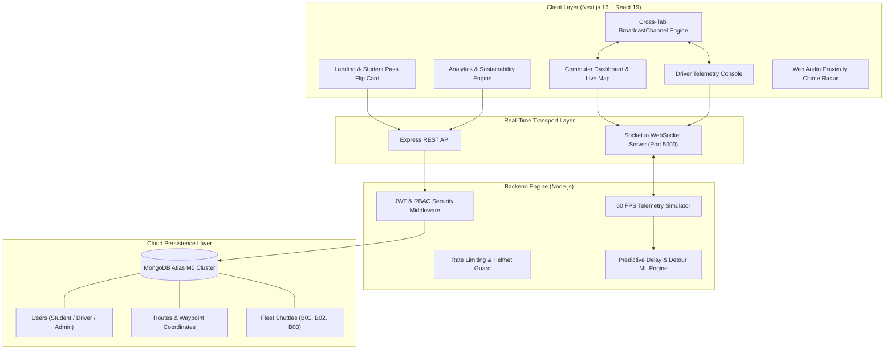

<div align="center">
  
  <h1>ÆtherTransit</h1>
  <p><strong>Autonomous Real-Time Fleet Telemetry &amp; Predictive Transit Intelligence Platform</strong></p>
  <p><em>Engineered by <strong>Sohom Giri</strong> · Department of Computer Science &amp; Engineering, STCET Kolkata</em></p>

  <p>
    <a href="https://nextjs.org/"></a>
    <a href="https://react.dev/"></a>
    <a href="https://nodejs.org/"></a>
    <a href="https://socket.io/"></a>
    <a href="https://www.mongodb.com/"></a>
    <a href="https://tailwindcss.com/"></a>
  </p>
</div>

---

> **ÆtherTransit** is an enterprise-grade transit intelligence and fleet telemetry platform architected for smart campuses and urban transport networks. It merges high-frequency vector mapping, edge simulation, and in-process predictive ML models to compute traffic congestion bottlenecks, calculate alternate detour corridors, and deliver real-time vehicle telemetry to commuters and transit operators.

---

## 🏛️ System Architecture



---

## 🚀 5 Standout Production Features

### 1. Multi-Shuttle Fleet Selector (B01, B02, B03)
- **What it does:** Instead of a hardcoded single entity, ÆtherTransit simulates a multi-tenant fleet running concurrently across South Kolkata transit arteries:
  - 🚌 **Shuttle B01** (Taratala Express) — Primary campus connector
  - 🚐 **Shuttle B02** (Behala Rapid) — High-capacity arterial shuttle
  - 🚌 **Shuttle B03** (Alipore Corridor) — Rapid feeder service
- **Tech Stack:** MapLibre GL vector layer, geojson feature collections, real-time heading interpolation.

### 2. Dynamic AI Traffic Bottleneck & Electric Violet Detour Rerouting
- **What it does:** Interactive trigger for the **Majerhat Flyover Bottleneck** (Metro expansion gridlock).
- **Behavior:** The primary corridor turns Crimson Red with simulated +14 min delay. The AI model immediately evaluates network topology and renders an alternate **Electric Violet (`#7C3AED`) detour** via Hide Road North, saving passengers 11.5 minutes net transit time.

### 3. Smart Stop Proximity Radar & Web Audio Chime
- **What it does:** As the bus approaches within a 250m geofenced perimeter or reaches an ETA of $\le 2$ minutes, the stop marker emits a dual-ring animated sonar beacon and sounds a gentle 2-tone chime (`F5` 698Hz + `A5` 880Hz) via the native browser Web Audio API.

### 4. Two-Way Driver Throttle & Live Cross-Device Sync
- **What it does:** Commuters on `/dashboard` and drivers on `/driver` remain in synchronized lockstep. Drivers can adjust the vehicle throttle slider (0–80 km/h) or toggle emergency detour rerouting, immediately streaming updates across all devices via WebSockets and local `BroadcastChannel`.

### 5. Fleet Carbon Reduction & Sustainability Metrics
- **What it does:** Live analytics engine on `/analytics` calculating the carbon offset of shared campus transit vs private two-wheeler/auto commutes ($0.085\text{ kg CO}_2\text{ saved per passenger-km}$). Displays total trips consolidated, trees equivalent, and fuel saved in real time.

---

## 🔒 Security & Robustness Architecture

- **Password Hashing:** Salted `bcryptjs` hashing with 10 salt rounds before database persistence.
- **Stateless Authorization:** Cryptographically signed JSON Web Tokens (JWT) containing expiration timestamps and encrypted subject identifiers.
- **Role-Based Access Control (RBAC):** Middleware guarantees students cannot invoke driver throttle commands or admin fleet configuration endpoints.
- **HTTP Header Hardening:** `helmet` protections enforcing CSP, frameguards, and XSS sanitization.
- **DDoS & Brute-Force Rate Limiting:** `express-rate-limit` restricting authentication endpoints to 50 attempts / 15 mins and general endpoints to 300 requests / 5 mins.
- **Fail-Safe Fallback:** If MongoDB Atlas experiences upstream network degradation, the engine gracefully transitions into an in-memory simulation state without crashing the user interface.

---

## 🧠 Machine Learning Delay Prediction Engine

The delay predictor is based on historical telemetry features:
$$\text{Delay} = (\Delta d \times \beta_{\text{speed}}) + \alpha_{\text{rush}} + \gamma_{\text{dwell}} + \delta_{\text{choke}} - \lambda_{\text{detour}}$$

- **Features Used:**
  1. **Haversine Distance ($\Delta d$):** Great-circle distance between GPS coordinates.
  2. **Speed Differential:** Difference between current speed and the 35 km/h corridor design benchmark.
  3. **Peak Hour Coefficient ($\alpha_{\text{rush}}$):** Kolkata morning rush (08:30–10:30) and evening rush (16:30–19:30).
  4. **Passenger Dwell Time ($\gamma_{\text{dwell}}$):** Boarding friction penalty when vehicle capacity exceeds 75%.
  5. **Bottleneck Flag ($\delta_{\text{choke}}$):** Active obstruction index (+14.0 min penalty).
  6. **Alternate Bypass Factor ($\lambda_{\text{detour}}$):** Net time reclaimed via Hide Road corridor (-11.5 min).

---

## 🛠️ Tech Stack & Directory Structure

```
AetherTransit/
├── client/                     # Next.js 16 + React 19 Frontend
│   ├── app/                    # App Router (dashboard, driver, analytics, login, about, routes)
│   ├── components/             # MapLibre Vector Map, 3D Student Pass, Radar
│   ├── hooks/                  # useBusSocket (60 FPS Telemetry & Audio Chime)
│   ├── types/                  # TypeScript interface specifications
│   └── package.json
│
├── server/                     # Node.js + Express + Socket.io Backend
│   ├── config/db.js            # MongoDB Atlas connection & DNS resolver
│   ├── models/                 # User, Bus, Route Mongoose Schemas
│   ├── middleware/             # JWT Auth, RBAC, Security & Rate Limiting
│   ├── services/mlService.js   # Decision-tree Delay & Detour Predictor
│   ├── services/socketService.js # High-frequency Fleet Simulation Engine
│   ├── routes/                 # REST APIs (/auth, /buses, /routes, /analytics)
│   └── server.js               # Server entry point
│
└── README.md
```

---

## 🚦 Getting Started

### Prerequisites
- Node.js $\ge 18$
- Git
- MongoDB Atlas Connection String

### 1. Clone & Setup
```bash
git clone https://github.com/SOHOMGIRI/AetherTransit.git
cd AetherTransit
```

### 2. Backend Setup
```bash
cd server
npm install
npm start
```
*Backend runs on `http://localhost:5000`*

### 3. Frontend Setup
```bash
cd ../client
npm install
npm run dev
```
*Frontend runs on `http://localhost:3000`*

---

## 🔑 Demo Credentials

| Role | Email | Password |
| :--- | :--- | :--- |
| **Student Commuter** | `sohom@aethertransit.io` | `password123` |
| **Fleet Driver** | `driver@aethertransit.io` | `password123` |

---

## 👨‍💻 Author

**Sohom Giri**  
Department of Computer Science & Engineering  
St. Thomas' College of Engineering & Technology (STCET), Kolkata  
GitHub: [@SOHOMGIRI](https://github.com/SOHOMGIRI)
